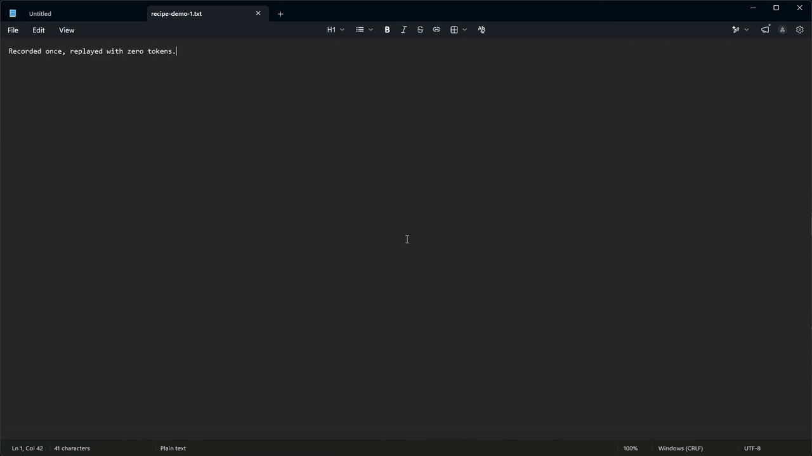
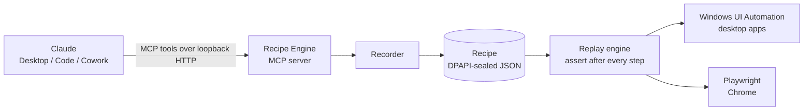
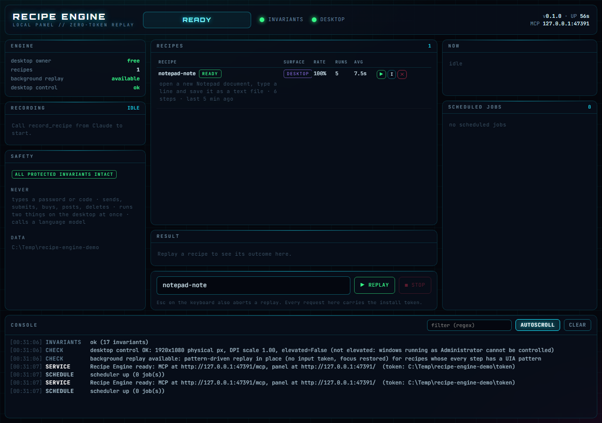

# Recipe Engine

Record a Windows desktop or browser workflow once with Claude, then replay it in
seconds with zero AI tokens. Every step is verified, and the engine refuses to type a
password or press Send, Buy or Delete no matter who asks.



## What it does

Claude (Desktop, Code or Cowork) drives your screen through Recipe Engine's own MCP
tools. While it works, the engine records what it did: which control it clicked
(by UI Automation identity, not just pixels), what it typed, and what the screen
looked like after each step. That trace is saved as a **recipe**.

Next time, `replay_recipe` runs the recipe with no model in the loop: no tokens,
no network calls, a few seconds instead of minutes. Each step is checked against
the window or page it expects; the first miss stops the replay with the step
number and the reason. Two consecutive failures quarantine the recipe until it is
re-recorded. Typed values can be parameters, so one recipe serves many inputs.

Some things the engine never does, whoever asks: type into a password field or
anything that looks like a credential, press Send / Submit / Buy / Pay / Post /
Delete, or replay past a login page. Those stay the user's own actions.

## Results

Measured on this machine on 2026-11-20 (Windows 11, 1920x1080 at 100 %). Every number
below comes from a test or script in this repository.

| Claim | How it is tested | Result |
|---|---|---|
| **Zero tokens on replay.** No model SDK is imported, nothing launches `claude`, replay opens no network connection. | `tests/test_zero_llm.py` (import hook, socket monkeypatch, AST scan of the package) and invariant 14 | 3/3 pass; the invariants self-test catches all 43 planted source mutations |
| **Replays succeed and are fast.** Record once, replay 50x into a fresh app each time, verify the app's own state (window title, Calculator result), not the engine's opinion. | `python tests/reliability_study.py --runs 50`, see [reports/reliability/report.md](reports/reliability/report.md) | Notepad **50/50**, median **2.46 s** (foreground); Calculator **50/50**, median **2.52 s** (all 50 in background mode) |
| **Never types a password, never presses Send.** Text and the focused control are both checked before any key event; destructive steps are dropped while recording and refused at replay, export and import. | `tests/test_redteam.py`: 27 unit cases plus one live WinForms password box on the real keyboard path | 27/27 unit cases pass; the live case passes under `pytest -m integration` (28/28) |

Full offline suite on 2026-11-20: **244 tests passed** (`pytest`), plus
`python -m recipe_engine.invariants --self-test` (43/43). Screenshot:
[docs/tests.png](docs/tests.png).

## How it works



**Identity-based element finding.** A desktop step stores the control's UI
Automation identity: AutomationId, name, control type, class, the ancestor chain
and which pattern it supports (Invoke, SetValue, Toggle, Select). At replay the
control is found by identity first (`recipe_engine/uia.py`, `resolver.py`). Pixel
coordinates are used only on an identical display, never in background mode, and
never when the recorded window is absent; otherwise the step fails as
`unresolvable_element` instead of guessing with your mouse.

**Per-step assertions.** Every step carries an `expect`: the next selector or URL
for browser steps, the foreground window title for desktop steps. The wait window
is sized from the recorded run (at least 5 s, at most 30 s). A desktop title must
hold for 500 ms so a window that flashes its final title while still opening does
not count.

**Quarantine.** Two consecutive failures, or a success rate under 70 % over the
last five runs, quarantine the recipe. The check happens before step 1, so a bad
recipe never touches the desktop. Re-recording clears it; recipes unused for 60
days are reported as stale and need a confirmation.

**Background replay.** A recipe whose every desktop step has a UI Automation
pattern replays through the app's own provider callbacks: no SendInput, no focus
change, your window is put back in front after every step. Other recipes replay in
the foreground with a "Recipe running - press Esc to abort" banner; Esc aborts
within 200 ms in either mode and releases every key.

The control panel at `http://127.0.0.1:47391/` (tray icon, *Open panel*) shows
recipes, run history, the live replay, scheduled jobs and the log:



## Safety

Seventeen properties are pinned in `recipe_engine/invariants.py` and re-checked at
every start by reading the source files from disk. While one is broken, every
acting tool answers `refused: invariants_failed`. The self-test applies 43 source
mutations (remove the credential check, drop the login detector, import a model
SDK, skip the signature check, and so on) and must catch all of them.

- `tests/test_redteam.py` tries every way a client could get the engine to type a
  secret or press Send: password fields, fields named like secrets, credential-
  looking text, destructive words in a recipe name, description or UI target, a
  recipe whose innocent name hides a Send button, and a live WinForms password box.
- The host binds **127.0.0.1 only** and requires `Authorization: Bearer <token>` on
  every request except `/api/health`. The token is 43 characters from
  `secrets.token_urlsafe`, stored with a current-user-only ACL and compared in
  constant time. Host and Origin headers must be loopback (DNS-rebinding protection).
- Recipes, the session snapshot, scheduled jobs and the export key are DPAPI-sealed
  for the current Windows user. Exports are HMAC-signed and carry no cookies,
  storage, secrets or run history; imports re-run every check.

The full threat model, including what the engine does not protect against, is in
[THREATS.md](THREATS.md).

## Quick start

Windows 10/11. Python 3.11+ to build from source, or the packaged host from the
[latest release](https://github.com/tgeorgopoulos/recipe-engine/releases/latest).

**Install the host (packaged):**

```powershell
powershell -ExecutionPolicy Bypass -File scripts\install-host.ps1
```

That downloads `recipe-engine-win64.zip` from the release, verifies its SHA-256,
unzips it to `%LOCALAPPDATA%\Programs\RecipeEngine`, writes your install token,
registers a per-user autostart and starts the host. No admin rights.

**Or from source:**

```powershell
pip install -e ".[bg,dev]"
python -m playwright install chromium
recipe-engine install          # token + autostart
recipe-engine serve            # tray icon + http://127.0.0.1:47391
```

**Connect a client.** Claude Desktop: double-click `recipe-engine.mcpb` from the
release. Claude Code / Cowork: install this repository as a plugin and paste the
output of `recipe-engine token` into the plugin's *Engine token* option.

**Record and replay.** In any client:

> "Record this as a recipe called weekly-timesheet" ... do the task once ... "stop recording".
> Next week: "run weekly-timesheet".

From the command line: `recipe-engine recipes list | replay NAME | stats NAME`,
`recipe-engine export NAME file.json`, `recipe-engine jobs add NAME "0 9 * * 1"`.
[samples/](samples/) holds six everyday recipes in the export format as templates.

## Tests

| Run | What it drives |
|---|---|
| `pytest` | nothing real: fake keyboard, fake pages, fake UI trees, a loopback HTTP fixture (244 tests) |
| `pytest -m slow` | real Chrome on a throwaway profile against a local fixture site (12 tests) |
| `pytest -m integration` | the real desktop: Notepad, Calculator, a WinForms password box, background replay, a real Esc (7 tests) |
| `pytest -m packaging` | `mcpb validate`, `claude plugin validate --strict`, the Node shim |
| `python -m recipe_engine.invariants --self-test` | 17 invariants, 43 mutations, outside pytest so no marker can skip it |
| `python tests/reliability_study.py --runs 50` | record once, replay 50x, verify the app's state; exit 1 below 95 % or above a 10 s median |

See [tests/README.md](tests/README.md). CI (`.github/workflows/ci.yml`, Windows
runner) runs all tiers; a `v*` tag builds the release.

## Limitations

- **Windows only.** UI Automation, DPAPI, the tray process and the per-user
  autostart are Windows APIs. The browser surface uses the real Chrome install.
- **Virtual desktops were tried and rejected.** Parking the app on a scratch
  virtual desktop would have hidden background replays completely, but a window
  moved off the active desktop loses its UI Automation subtree (Store Notepad
  exposes 6 nodes and no editor there), so nothing can be resolved by identity.
  Background replay therefore runs in place, by patterns only; `vdesk.py` is kept
  as a probe and `engine_status` reports the result.
- **Cowork sandbox reach is unverified.** Whether Cowork's sandbox can reach the
  host's loopback address has not been tested. `recipe-engine serve --bind <adapter IP>`
  widens the listener; the token stays mandatory.
- **Recipes are single-surface.** A workflow that spans browser and desktop is two
  recipes, with the file path handed over in `read_texts`.
- **DPI coverage is synthetic.** 1440p/125 % and 4K/150 % displays are covered by
  display stamps and arithmetic in `tests/test_uia_resolver.py`, not by hardware.
- **Heuristics are heuristics.** The credential regex, the IsPassword check and the
  destructive-word list are belts and braces, not an understanding of intent; see
  THREATS.md.

## Tech stack

Python 3.11+, MCP (streamable HTTP and stdio) on Starlette/uvicorn, Windows UI
Automation via `uiautomation`, pyautogui, Playwright on Chrome, Windows DPAPI,
pystray, PyInstaller; a dependency-free Node shim for the `.mcpb` extension;
GitHub Actions on a Windows runner. MIT licence.
